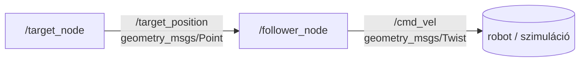

# target_follower

ROS 2 Python package, amely egy szimulált célpontot generál és egy követő node-dal irányítási parancsokat számol hozzá.

## Csomag felépítése

A package két node-ból áll:

- **`target_node`**: másodpercenként egy véletlenszerűen "elsétáló" 2D célpontot (`geometry_msgs/Point`) publikál a `/target_position` topicon.
- **`follower_node`**: feliratkozik a `/target_position` topicra, kiszámolja a saját (fix) pozíciójától vett távolságot és szöget a célponthoz, majd ebből egy `geometry_msgs/Twist` vezérlési parancsot publikál a `/cmd_vel` topicon.

## Node-topic kapcsolatok



## Build

Workspace: `~/ros2_ws/`

```bash
cd ~/ros2_ws/src
git clone https://github.com/lolinfin-creator/gyo_d3p_ajrp.git
cd ~/ros2_ws
colcon build --packages-select target_follower --symlink-install
source install/setup.bash
```

## Futtatás

```bash
ros2 launch target_follower target_follower.launch.py
```

Ez elindítja mindkét node-ot. A terminálban váltakozva láthatók a célpont pozíciói és a követő node által számolt távolság/szög értékek.

## Üzenettípusok

| Topic | Típus | Publisher | Subscriber |
|---|---|---|---|
| `/target_position` | `geometry_msgs/Point` | `target_node` | `follower_node` |
| `/cmd_vel` | `geometry_msgs/Twist` | `follower_node` | — |

## Megvalósítás

ROS 2 Humble alatt, Ubuntu 22.04 (WSL2) környezetben.